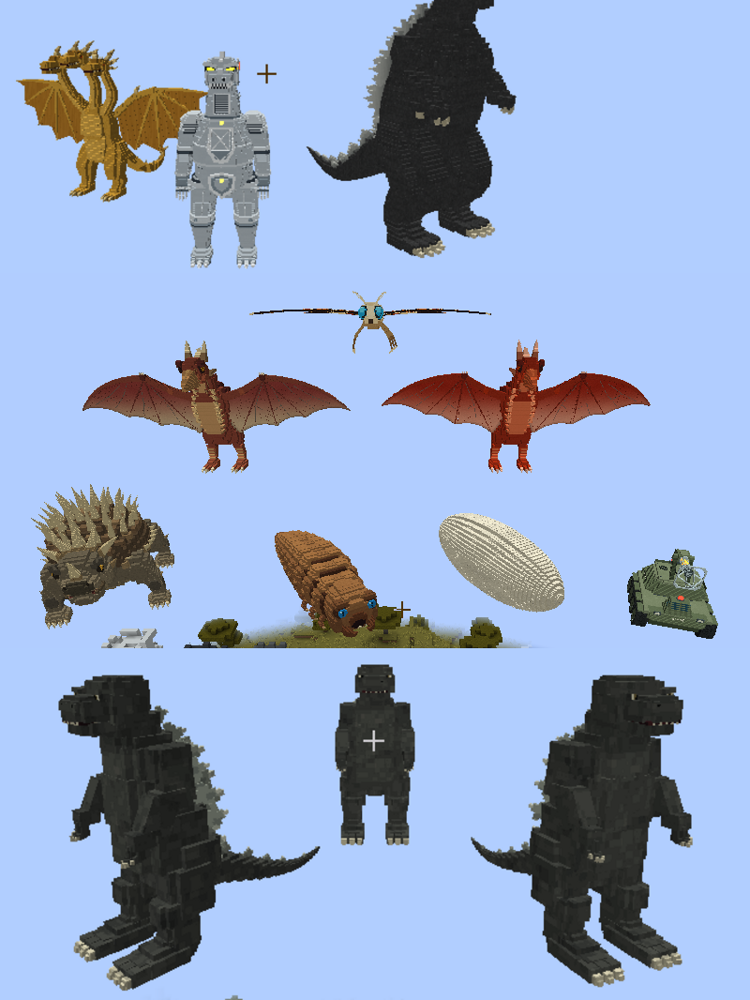

# Model sizes

Every model the mod needs, with the height to build it at in Blockbench and the size it ends up in game.

- **Build height** is the current stand-in's height. Hitboxes, beam start points and extra hit parts are tuned to it, so a model built at that height lines up without code changes. 1 block = 16 px; feet at y = 0, facing north (-z).
- **In game** is measured from the game at the default config (`kaiju.scale` = 1.0, one fifth of film size). Changing that setting scales every kaiju.
- Several forms can share one model at different sizes (Baby, Little and Junior Godzilla, say): build it once, at the build height.
- Files go in `assets/reikogodzilla/geo/entity/<name>.geo.json`, `animations/entity/<name>.animation.json` and `textures/entity/<name>.png` (see the README for bones and animation names).

## Phase 1: Showa/Heisei icons

Reiko's Blockbench models are in for everything here. Heisei Godzilla's was built at its 19.2-block size in game and halved to the 9.6-block build height when it was added.

| Model file | Monster | Build height (Blockbench) | In game (blocks) | Model |
| --- | --- | --- | --- | --- |
| `godzilla_showa` | Godzilla (Showa) | 9.6 blocks (154 px) | 9.6 tall · 10.6 long · 4.3 wide | ✅ Reiko's model |
| `godzilla_heisei` | Godzilla (Heisei) | 9.6 blocks (154 px) | 19.2 tall · 21.2 long · 8.6 wide | ✅ Reiko's model |
| `king_ghidorah` | King Ghidorah | 12.8 blocks (204 px) | 12.8 tall · 11 long · 19.6 wide | ✅ Reiko's model |
| `mothra_larva` | Mothra larva | 2.4 blocks (38 px) | 2.4 tall · 9.8 long · 2.6 wide | ✅ Reiko's model |
| `mothra_cocoon` | Mothra cocoon | 3 blocks (48 px) | 3 tall · 7.6 long · 2.6 wide | ✅ Reiko's model |
| `mothra` | Mothra | 3.3 blocks (53 px) | 3.3 tall · 8 long · 14.8 wide | ✅ Reiko's model |
| `rodan` | Rodan | 6.2 blocks (100 px) | 6.2 tall · 6.3 long · 14.4 wide | ✅ Reiko's model |
| `anguirus` | Anguirus | 4.4 blocks (70 px) | 4.4 tall · 11.6 long · 4.6 wide | ✅ Reiko's model |
| `mechagodzilla` | Mechagodzilla (Showa) | 9.6 blocks (154 px) | 9.6 tall · 10.6 long · 4.3 wide | ✅ Reiko's model |
| `maser_tank` | Maser Tank | 2.8 blocks (44 px) | 2.8 tall · 3.7 long · 2.8 wide | ✅ Reiko's model |

## Phase 2: Heisei

| Model file | Monster | Build height (Blockbench) | In game (blocks) |
| --- | --- | --- | --- |
| `godzilla_junior` | Baby Godzilla | 9.6 blocks (154 px) | 2.4 tall · 2.6 long · 1.1 wide |
| `godzilla_junior` | Little Godzilla | 9.6 blocks (154 px) | 4.3 tall · 4.8 long · 1.9 wide |
| `godzilla_junior` | Godzilla Junior | 9.6 blocks (154 px) | 7.7 tall · 8.5 long · 3.4 wide |
| `biollante_flower` | Biollante (rose) | 12.6 blocks (202 px) | 9.5 tall · 10.2 long · 10.2 wide |
| `biollante_plant` | Biollante (plant beast) | 13 blocks (208 px) | 14.9 tall · 13.6 long · 15.6 wide |
| `battra_larva` | Battra larva | 3.8 blocks (61 px) | 3.8 tall · 13.9 long · 3.5 wide |
| `battra` | Battra | 3.6 blocks (58 px) | 3.6 tall · 8.9 long · 16.6 wide |
| `space_godzilla` | SpaceGodzilla | 9.6 blocks (154 px) | 23 tall · 25.4 long · 11.5 wide |
| `space_crystal` | Space crystal | 8 blocks (128 px) | 8 tall · 2.6 long · 2.5 wide |
| `destoroyah_juvenile` | Destoroyah juvenile | 4.4 blocks (70 px) | 4.4 tall · 11.6 long · 4.6 wide |
| `destoroyah_aggregate` | Destoroyah (aggregate) | 4.4 blocks (70 px) | 4.4 tall · 11.6 long · 4.6 wide |
| `destoroyah_flying` | Destoroyah (flying) | 5.4 blocks (87 px) | 5.4 tall · 7.6 long · 14.8 wide |
| `destoroyah_perfect` | Destoroyah (perfect) | 9.6 blocks (154 px) | 9.6 tall · 10.6 long · 13 wide |
| `mechagodzilla_heisei` | Mechagodzilla (Heisei) | 9.6 blocks (154 px) | 19.2 tall · 21.2 long · 8.6 wide |
| `super_mechagodzilla` | Super Mechagodzilla | 9.6 blocks (154 px) | 19.2 tall · 21.2 long · 8.6 wide |
| `garuda` | Garuda | 2.4 blocks (38 px) | 2.4 tall · 5 long · 4.6 wide |
| `moguera` | MOGUERA | 9.6 blocks (154 px) | 19.2 tall · 21.2 long · 8.6 wide |
| `star_falcon` | Star Falcon | 2.6 blocks (42 px) | 2.6 tall · 6 long · 5.4 wide |
| `land_moguera` | Land Moguera | 1.8 blocks (29 px) | 1.8 tall · 5.3 long · 2.8 wide |
| `super_x` | Super X | 2.2 blocks (35 px) | 2.2 tall · 6.6 long · 6.2 wide |
| `super_x2` | Super X2 | 1.9 blocks (30 px) | 1.9 tall · 7 long · 6.6 wide |
| `super_x3` | Super X3 | 2 blocks (32 px) | 2 tall · 7.4 long · 10.8 wide |
| `freezer_tank` | Freezer Tank | 2.8 blocks (44 px) | 2.8 tall · 3.7 long · 2.8 wide |

Super Mechagodzilla is Mechagodzilla with Garuda docked on its back: same size as the Heisei Mechagodzilla.

## Phase 3: MonsterVerse

| Model file | Monster | Build height (Blockbench) | In game (blocks) |
| --- | --- | --- | --- |
| `godzilla_mv` | Godzilla (MonsterVerse) | 9.6 blocks (154 px) | 23 tall · 25.4 long · 10.3 wide |
| `godzilla_evolved` | Godzilla (Evolved) | 9.6 blocks (154 px) | 23 tall · 25.4 long · 10.3 wide |
| `kong` | Kong (young) | 9.6 blocks (154 px) | 6.2 tall · 4 long · 4 wide |
| `kong` | Kong (adult) | 9.6 blocks (154 px) | 19.7 tall · 12.7 long · 12.6 wide |
| `suko` | Suko | 9.6 blocks (154 px) | 8.6 tall · 4 long · 5.4 wide |
| `great_ape` | Great Ape | 4 blocks (64 px) | 4 tall · 1.9 long · 2.5 wide |
| `skar_king` | Skar King | 9.6 blocks (154 px) | 18.7 tall · 19.5 long · 11.7 wide |
| `shimo` | Shimo | 12.3 blocks (197 px) | 28.3 tall · 43.4 long · 11.5 wide |
| `muto_male` | MUTO (male) | 5.9 blocks (95 px) | 7.7 tall · 9.8 long · 20.8 wide |
| `muto_female` | MUTO (female) | 5.4 blocks (86 px) | 10.3 tall · 14.1 long · 16.9 wide |
| `skullcrawler` | Skullcrawler | 2.1 blocks (34 px) | 2.1 tall · 9.3 long · 2 wide |
| `skull_devil` | Skull Devil | 5.9 blocks (94 px) | 5.9 tall · 26 long · 5.6 wide |
| `warbat` | Warbat | 3.3 blocks (53 px) | 3.3 tall · 10.8 long · 15.2 wide |
| `king_ghidorah_mv` | King Ghidorah (MonsterVerse) | 13.4 blocks (214 px) | 29.5 tall · 26.4 long · 44 wide |
| `scylla` | Scylla | 9.4 blocks (151 px) | 18.8 tall · 14.7 long · 26.2 wide |
| `behemoth` | Behemoth | 9.8 blocks (158 px) | 21.7 tall · 38.9 long · 10.1 wide |
| `methuselah` | Methuselah | 9.4 blocks (151 px) | 18.9 tall · 37.2 long · 13.2 wide |
| `tiamat` | Tiamat | 3.6 blocks (58 px) | 6.2 tall · 30.3 long · 8 wide |
| `apex_mechagodzilla` | Mechagodzilla (Apex) | 9.6 blocks (154 px) | 23 tall · 29.3 long · 10.3 wide |
| `heav` | HEAV | 2.6 blocks (42 px) | 2.6 tall · 4 long · 3.6 wide |

## Phase 4: Showa and Millennium

| Model file | Monster | Build height (Blockbench) | In game (blocks) |
| --- | --- | --- | --- |
| `gigan` | Gigan (Showa) | 9.6 blocks (154 px) | 13 tall · 14.4 long · 17.6 wide |
| `hedorah_aquatic` | Hedorah (sea form) | 1.8 blocks (29 px) | 1.8 tall · 4.9 long · 2.9 wide |
| `hedorah_land` | Hedorah (land form) | 5.9 blocks (95 px) | 5.9 tall · 15.7 long · 6.2 wide |
| `hedorah_flying` | Hedorah (flying form) | 2.2 blocks (35 px) | 2.2 tall · 6.4 long · 6.8 wide |
| `hedorah_perfect` | Hedorah (perfect form) | 12 blocks (192 px) | 12 tall · 5.1 long · 5.4 wide |
| `megalon` | Megalon | 11 blocks (176 px) | 12.6 tall · 12.2 long · 4.9 wide |
| `jet_jaguar` | Jet Jaguar (human-sized) | 10.6 blocks (170 px) | 2 tall · 0.8 long · 0.8 wide |
| `jet_jaguar` | Jet Jaguar (giant) | 10.6 blocks (170 px) | 11.1 tall · 4.3 long · 4.5 wide |
| `ebirah` | Ebirah | 2.8 blocks (45 px) | 2.8 tall · 14.8 long · 6.7 wide |
| `kumonga` | Kumonga | 4.8 blocks (77 px) | 4.8 tall · 8.8 long · 10.1 wide |
| `kamacuras` | Kamacuras | 5.6 blocks (90 px) | 5.6 tall · 8 long · 9.2 wide |
| `minilla` | Minilla (baby) | 9.6 blocks (154 px) | 2.6 tall · 2.9 long · 1.2 wide |
| `minilla` | Minilla (grown) | 9.6 blocks (154 px) | 3.6 tall · 4 long · 1.6 wide |
| `gorosaurus` | Gorosaurus | 9.6 blocks (154 px) | 7.1 tall · 8.3 long · 3.2 wide |
| `manda` | Manda | 3.6 blocks (58 px) | 3.6 tall · 28.9 long · 6 wide |
| `baragon` | Baragon | 4.8 blocks (77 px) | 5.3 tall · 12.8 long · 5.1 wide |
| `varan` | Varan | 5.6 blocks (90 px) | 5.6 tall · 16 long · 8.8 wide |
| `king_caesar` | King Caesar | 10.4 blocks (166 px) | 10.9 tall · 11.1 long · 4.5 wide |
| `titanosaurus` | Titanosaurus | 10.6 blocks (170 px) | 13.2 tall · 14.2 long · 5.4 wide |
| `godzilla_millennium` | Godzilla 2000 | 9.6 blocks (154 px) | 11 tall · 12.2 long · 4.9 wide |
| `godzilla_gmk` | Godzilla (GMK) | 9.6 blocks (154 px) | 12 tall · 13.2 long · 5.4 wide |
| `godzilla_kiryu_era` | Godzilla (2002-03) | 9.6 blocks (154 px) | 11 tall · 12.2 long · 4.9 wide |
| `godzilla_final_wars` | Godzilla (Final Wars) | 9.6 blocks (154 px) | 20.2 tall · 22.3 long · 9 wide |
| `orga` | Orga | 9.6 blocks (154 px) | 12 tall · 5.8 long · 7.5 wide |
| `millennian_ufo` | Millennian UFO | 3 blocks (48 px) | 3 tall · 12.6 long · 12.6 wide |
| `megaguirus` | Megaguirus | 3.4 blocks (55 px) | 3.4 tall · 12.5 long · 15.4 wide |
| `meganulon` | Meganulon | 1.1 blocks (17 px) | 1.1 tall · 4.7 long · 1 wide |
| `meganula` | Meganula | 1 blocks (16 px) | 1 tall · 2.1 long · 2.8 wide |
| `king_ghidorah_gmk` | King Ghidorah (GMK) | 13.4 blocks (214 px) | 10.1 tall · 9 long · 15 wide |
| `kiryu` | Kiryu | 9.6 blocks (154 px) | 12 tall · 13.2 long · 5.4 wide |
| `monster_x` | Monster X | 9.6 blocks (154 px) | 24 tall · 26.5 long · 10.8 wide |
| `keizer_ghidorah` | Keizer Ghidorah | 13.4 blocks (214 px) | 28.8 tall · 25.8 long · 43 wide |
| `zilla` | Zilla | 9.6 blocks (154 px) | 18.2 tall · 20.1 long · 8.2 wide |
| `gotengo` | Gotengo | 7.6 blocks (122 px) | 7.6 tall · 30.4 long · 10.4 wide |
| `xilien_saucer` | Xilien saucer | 1.2 blocks (19 px) | 1.2 tall · 3.8 long · 3.8 wide |

## Phase 5: Reiwa and modern

| Model file | Monster | Build height (Blockbench) | In game (blocks) |
| --- | --- | --- | --- |
| `shin_godzilla_2` | Shin Godzilla (2nd form) | 4.4 blocks (70 px) | 5.7 tall · 15.1 long · 6.5 wide |
| `shin_godzilla_3` | Shin Godzilla (3rd form) | 9.6 blocks (154 px) | 11 tall · 15.6 long · 4.9 wide |
| `shin_godzilla` | Shin Godzilla (4th form) | 9.6 blocks (154 px) | 20.6 tall · 35.7 long · 9.2 wide |
| `godzilla_odo` | Odo Island creature | 9.6 blocks (154 px) | 3.1 tall · 3.4 long · 1.4 wide |
| `godzilla_minus_one` | Godzilla (Minus One) | 9.6 blocks (154 px) | 9.6 tall · 10.6 long · 4.3 wide |
| `ghidorah_minus_zero` | Ghidorah (Minus Zero, one head) | 12.8 blocks (204 px) | 12.8 tall · 11 long · 19.6 wide |
| `king_ghidorah_minus_zero` | King Ghidorah (Minus Zero) | 13.4 blocks (214 px) | 18.1 tall · 16.2 long · 27 wide |
| `godzilla_earth` | Godzilla Earth | 9.6 blocks (154 px) | 46.1 tall · 50.9 long · 20.6 wide |
| `servum` | Servum (flyer) | 3.1 blocks (50 px) | 1.9 tall · 3.5 long · 6.7 wide |
| `servum_worm` | Servum (burrower) | 1.4 blocks (22 px) | 1.7 tall · 7.3 long · 2.2 wide |
| `vulture` | Vulture | 2.5 blocks (40 px) | 2.5 tall · 2.8 long · 3.4 wide |
| `mechagodzilla_city` | Mechagodzilla City core | 7.5 blocks (120 px) | 7.5 tall · 6.4 long · 5.6 wide |
| `planet_eater_ghidorah` | Ghidorah, the Planet Eater (one neck) | 1.7 blocks (27 px) | 5 tall · 25.6 long · 6.5 wide |
| `godzilla_aquatilis` | Godzilla Aquatilis | 1.7 blocks (27 px) | 2.7 tall · 11.4 long · 4 wide |
| `godzilla_amphibia` | Godzilla Amphibia | 4.4 blocks (70 px) | 8.8 tall · 23.2 long · 9.2 wide |
| `godzilla_terrestris` | Godzilla Terrestris | 6.7 blocks (108 px) | 6.7 tall · 7.4 long · 3 wide |
| `godzilla_ultima` | Godzilla Ultima | 9.6 blocks (154 px) | 9.6 tall · 10.6 long · 4.3 wide |
| `jet_jaguar_pp` | Jet Jaguar SP (prototype) | 9.6 blocks (154 px) | 2.9 tall · 3.2 long · 1.3 wide |
| `jet_jaguar_pp` | Jet Jaguar β | 9.6 blocks (154 px) | 4.8 tall · 5.3 long · 2.1 wide |
| `jet_jaguar_pp` | Jet Jaguar PP | 9.6 blocks (154 px) | 19.2 tall · 21.2 long · 8.6 wide |
| `salunga` | Salunga | 7.7 blocks (123 px) | 7.7 tall · 8.5 long · 3.4 wide |
| `titan_x` | Titan X | 4 blocks (63 px) | 9.5 tall · about 14 across (tentacles all round) |
| `scarab` | Scarab | 0.3 blocks (4 px) | 0.3 tall · 1.2 long · 0.3 wide |
| `frost_vark` | Frost Vark | 4.8 blocks (76 px) | 7.6 tall · 17.5 long · 4.2 wide |
| `ion_dragon` | Ion Dragon | 3.7 blocks (60 px) | 2.8 tall · 6.2 long · 11.7 wide |
| `kraken` | Kraken | 3.4 blocks (54 px) | 6.8 tall · about 12 across (tentacles all round) |
| `shinden` | Shinden | 2 blocks (32 px) | 2 tall · 4 long · 4.4 wide |

Godzilla Earth's size follows `reiwa.godzillaEarthScale` (4.8 by default; 6.0 is the true 300 m). Godzilla Ultima grows up to twice as big while surrounded by Red Dust.

## Textures that reuse a model

No new model: paint a texture for the listed model. The size in game is the form's own. The ones on Phase 1 models (`rodan_fire`, `rodan_mv`, `rodan_sp`, `mothra_mv`, `mothra_gmk`, `battra_cocoon`, `mechagodzilla_2`) are recoloured copies of Reiko's textures for now, so they already fit the new UV layout.

| Texture | Monster | Paint on model | In game (blocks) |
| --- | --- | --- | --- |
| `rodan_fire` | Fire Rodan | `rodan` | 6.2 tall · 6.3 long · 14.4 wide |
| `rodan_mv` | Rodan (MonsterVerse) | `rodan` | 11.8 tall · 12 long · 27.4 wide |
| `mothra_mv` | Mothra (MonsterVerse) | `mothra` | 6.6 tall · 16 long · 29.6 wide |
| `battra_cocoon` | Battra cocoon | `mothra_cocoon` | 3 tall · 7.6 long · 2.6 wide |
| `mechagodzilla_2` | Mechagodzilla 2 | `mechagodzilla` | 9.6 tall · 10.6 long · 4.3 wide |
| `space_godzilla_mv` | SpaceGodzilla (MonsterVerse placeholder) | `space_godzilla` | 26.9 tall · 29.7 long · 13.4 wide |
| `gigan_final_wars` | Gigan (Final Wars) | `gigan` | 24 tall · 26.8 long · 32.5 wide |
| `gigan_rex` | Gigan Rex | `gigan` | 21.1 tall · 23.5 long · 28.6 wide |
| `gigan_miles` | Gigan Miles | `gigan` | 14.4 tall · 16 long · 19.5 wide |
| `hedorah_final_wars` | Hedorah (Final Wars) | `hedorah_perfect` | 24 tall · 10.2 long · 10.8 wide |
| `ebirah_final_wars` | Ebirah (Final Wars) | `ebirah` | 5.6 tall · 29.6 long · 13.4 wide |
| `kumonga_final_wars` | Kumonga (Final Wars) | `kumonga` | 6.5 tall · 11.9 long · 13.6 wide |
| `kamacuras_final_wars` | Kamacuras (Final Wars) | `kamacuras` | 10.1 tall · 14.4 long · 16.6 wide |
| `manda_final_wars` | Manda (Final Wars) | `manda` | 5.8 tall · 46.2 long · 9.6 wide |
| `baragon_gmk` | Baragon (GMK) | `baragon` | 6.2 tall · 15.1 long · 6 wide |
| `king_caesar_final_wars` | King Caesar (Final Wars) | `king_caesar` | 21.8 tall · 22.3 long · 9 wide |
| `mothra_gmk` | Mothra (GMK) | `mothra` | 3.3 tall · 8 long · 14.8 wide |
| `king_ghidorah_dragon_king` | King Ghidorah (Dragon King) | `king_ghidorah_gmk` | 10.1 tall · 9 long · 15 wide |
| `kiryu_kai` | Kiryu Kai | `kiryu` | 12 tall · 13.2 long · 5.4 wide |
| `godzilla_minus_zero` | Godzilla (Minus Zero) | `godzilla_minus_one` | 11.5 tall · 12.7 long · 5.2 wide |
| `godzilla_filius` | Godzilla Filius | `godzilla_earth` | 9.6 tall · 10.6 long · 4.3 wide |
| `rodan_sp` | Rodan SP (juvenile) | `rodan` | 2.2 tall · 2.2 long · 5 wide |
| `rodan_sp` | Rodan SP (flock leader) | `rodan` | 6.8 tall · 7 long · 15.8 wide |

Godzilla (Minus Zero) follows `reiwa.minusZeroScale` (1.2 by default; there's no official height yet).
