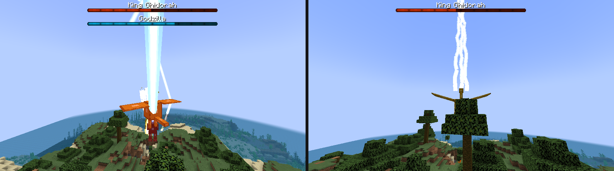
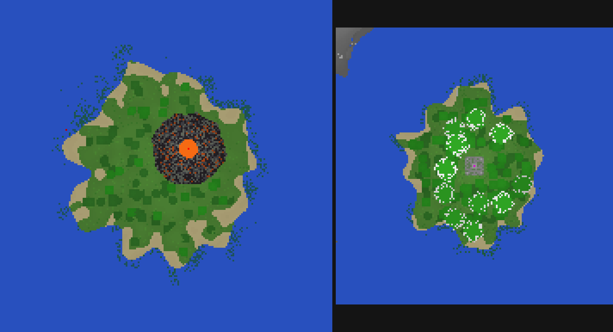

# Reiko's Godzilla Mod

Giant monsters from every era of Godzilla films, for **Minecraft 1.21.1 (NeoForge)**.

Kaiju fight each other, level terrain with charged beam attacks, and can be fought with film-inspired human tech like the Maser Tank and the Oxygen Destroyer. The mod is built in five phases (Showa/Heisei icons → Heisei → MonsterVerse → Showa & Millennium deep cuts → Reiwa & modern films). See **[ROADMAP.md](ROADMAP.md)**.

> Unofficial fan project. Godzilla and related characters are trademarks of Toho Co., Ltd.; MonsterVerse designs belong to Legendary. This mod contains no ripped models, logos or film audio.



## Requirements

- Minecraft 1.21.1
- NeoForge 21.1.x
- [GeckoLib](https://www.curseforge.com/minecraft/mc-mods/geckolib) 4.9.3 or newer for NeoForge 1.21.1

## What's in Phase 1

### Monsters

| Kaiju | Side | Size (default scale) | Abilities |
|---|---|---|---|
| **Godzilla** (Showa / Heisei) | Titan | ~10 / ~20 blocks | Atomic breath (dorsal plates charge up first), tail swipe, roar, nuclear pulse (Heisei), fast regeneration |
| **King Ghidorah** | Invader | ~13 blocks, flies | Three gravity beams (each head can aim at a different enemy), hurricane wing gusts, calls lightning |
| **Mothra** (larva → cocoon → imago) | Guardian | larva ~6 long, imago ~18 wingspan | Larva: silk spray. Imago: poison scale clouds, hurricane gusts. Defends players from hostile kaiju |
| **Rodan** | Titan | ~5 blocks, ~18 wingspan | Supersonic dive with a sonic boom, wing gusts |
| **Anguirus** | Titan | ~12 long | Spiked shell (thorns), Thunderball roll. Tameable and rideable |
| **Mechagodzilla** (Showa) | Invader | ~10 blocks | Rainbow Space Beam, finger missiles, spinning-head force field, "Fake Godzilla" disguise |

**Sides:** Titans and Guardians leave players alone unless attacked, and fight Invaders. Invaders attack everyone. Godzilla can be made hostile to players in the config (1954 behaviour).

Kaiju have boss bars, extra hitboxes for heads, tails and wings (head hits do more damage), wade along the sea floor, and smash through anything in their path.

### Tech and items

- **Type 66 Maser Tank**: place it, use it to climb in. W/S drive, A/D turn, **R** fires the maser where you look. Unmanned tanks guard the area and shoot hostile kaiju. Sneak + use packs it up; iron ingots repair it.
- **Oxygen Destroyer**: throw it into water. Every living thing in the water nearby dies, kaiju lose most of their health and can't regenerate for two minutes.
- **Kaiju drops**: G-Cells (Godzilla), Space Titanium (Mechagodzilla), Ghidorah Scales, Mothra Scales, Kaiju Scales. These feed into later phases' tech.

| Recipe | Pattern |
|---|---|
| Oxygen Destroyer | ` G ` / `PHP` / `IDI`: glass, prismarine crystals, heart of the sea, iron ingots, diamond |
| Maser Tank | ` D ` / `RIR` / `ICI`: diamond, redstone blocks, iron blocks, minecart |

### World

- **Monster Island** (open ocean): a volcanic island. Godzilla rests just offshore, Rodan nests in the lava-filled crater and Anguirus roams the plateau. They appear when you get close.
- **Infant Island** (warm oceans): jungle island with a stone shrine holding **Mothra's Egg**. While you're nearby the egg cracks and hatches a larva (sometimes twins). Larvae spin a cocoon after a while and emerge as Mothra.
- **Kaiju events** (from day 5, roughly every few days): Godzilla surfaces offshore and heads inland, a golden meteor crashes and King Ghidorah climbs out, or "Godzilla" walks in from the horizon... and turns out to be Mechagodzilla.



### Taming Anguirus

Feed it any meat until hearts appear. Then: sneak + use to make it sit or follow, use a saddle on it, and use it again to ride. While riding, press **R** to roll in the direction you're looking. It defends you and attacks whatever you attack.

## Commands

`/kaiju event <godzilla|ghidorah|mechagodzilla>` starts an event near you (needs operator permissions).

## Config

`config/reikogodzilla-common.toml`:

- `kaiju.scale`: size of every kaiju (1.0 = one fifth of film size).
- `kaiju.godzillaHostileToPlayers`, `kaiju.bossBars`, `kaiju.playerDamageMultiplier`, `kaiju.mothraGrowthTicks`
- `destruction.kaijuGriefing`, `beamBlockDamage`, `beamFire`, `maxBlocksPerTick`, `maxBlockResistance` (block breaking also respects the `mobGriefing` game rule)
- `events.enabled`, `firstDay`, `intervalTicks`, `chance`, `maxKaijuNearPlayer`
- `weapons.maserAutoFire`, `maserDamage`, `oxygenDestroyerKaijuDamage`

## Custom models (Blockbench)

Every kaiju currently uses a plain **stand-in model** so the mod is playable. To use your own, make a GeckoLib model in Blockbench (*GeckoLib Animated Model* project type, entity) and export three files with the same name, replacing the stand-ins:

```
src/main/resources/assets/reikogodzilla/geo/entity/<name>.geo.json
src/main/resources/assets/reikogodzilla/animations/entity/<name>.animation.json
src/main/resources/assets/reikogodzilla/textures/entity/<name>.png
```

Names: `godzilla_showa`, `godzilla_heisei`, `king_ghidorah`, `mothra_larva`, `mothra_cocoon`, `mothra`, `rodan`, `anguirus`, `mechagodzilla`, `maser_tank`.

**Bones:** a bone named `head` turns to follow where the kaiju is looking. Everything else is up to you.

**Animations** the code plays. Use these exact names; if one is missing, that move simply won't animate:

| Animation | When |
|---|---|
| `idle`, `walk`, `fly` | Always (fly only for flying kaiju) |
| `attack` | Melee strike (played once) |
| `roar` | Roar ability and triggered roars |
| `charge` | Wind-up before most special attacks (atomic breath charge-up, etc.) |
| `beam` | While a beam is firing |
| `tail` | Godzilla's tail swipe |
| `pulse` | Heisei Godzilla's nuclear pulse |
| `gust` | Wing gust (Ghidorah, Mothra, Rodan) |
| `scales` | Mothra's poison scales |
| `spray` | Mothra larva's silk spray |
| `dive` | Rodan's sonic dive |
| `curl`, `roll` | Anguirus's Thunderball |
| `sit` | Tamed Anguirus sitting |
| `missiles`, `shield` | Mechagodzilla's finger missiles and force field |
| `cocoon` | Mothra's cocoon |

Beam start points (mouths, Ghidorah's three heads, Mechagodzilla's eyes) and extra hitboxes are set in each kaiju's class (`beamLocalOffset` and `createParts`), measured in blocks at scale 1 with +z forward. Adjust them if your model's proportions differ.

## Sounds

Sounds are currently re-pitched vanilla sounds. To use your own, put `.ogg` files in `src/main/resources/assets/reikogodzilla/sounds/` and point the entries in `assets/reikogodzilla/sounds.json` at them (for example `"reikogodzilla:godzilla_roar"`).

## Building

```
./gradlew build
```

The mod jar ends up in `build/libs/`. Use `./gradlew runClient` to launch a test game.
